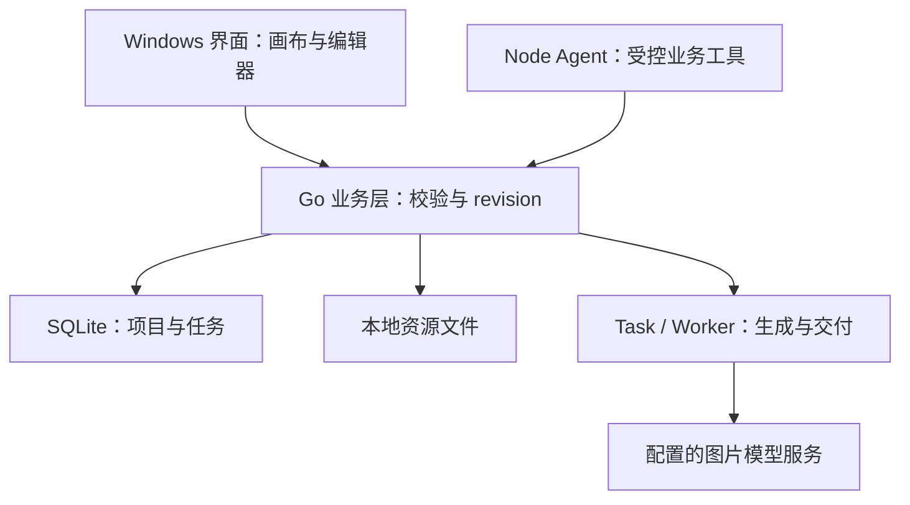

# AI 媒体创作平台 Demo：第四阶段技术方案与开发交接报告

- **版本**：V1.0
- **整理日期**：2026 年 10 月 19 日（北京时间）
- **阶段**：第四阶段——技术调研、架构设计与开发准备
- **决策状态**：T401 调研完成；T402～T406 方案已在讨论中通过；第四阶段正式收口
- **执行状态**：按用户最后指示，实际开发与测试暂不启动
- **用途**：保存阶段结论，作为后续 BeefTV 二次开发、任务编写及验收的交接依据

> “已通过”表示讨论方案获得用户认可，不表示老板已正式批准、代码已经实现、真实模型已经可用或 Windows 验收已经通过。本次只整理文档，不启动 DEV-001，不检查或修改项目源码，不安装项目依赖、不运行应用或测试，不发起模型调用。
>
> 本文是结构化决策报告，不是逐字聊天存档。依据为当前可取得的 T401 原始报告、第三阶段现行报告、第四阶段收口讨论和已确认的 AI 编程规范。部分早期子项原文未能完整取回；正文仅归纳可核实结论，未核实的 GAP 原表及子项编号明确保留追溯缺口，不以推断补造。

## 目录

1. 阶段结论与状态
2. 依据、证据与适用边界
3. T401：技术调研结论
4. T402：复用与改造策略
5. T403：客户端架构
6. T404：创作数据与交互一致性
7. T405：模型、Agent 与生成任务
8. 冻结的 Demo 范围与验收流程
9. T406：实施工作包与重点验证项
10. T406-05：AI 编程规范
11. 单次开发任务与交付模板
12. T406-06：开发准入与阶段收口
13. 风险、资源与未验证假设
14. 后续交接与文档维护

## 一、阶段结论与状态

产品方向为通用型专业 AI 媒体创作平台，优先采用 Windows x64 桌面客户端，以无限画布为主要创作空间，支持 Agent 与用户共同处理文本、分镜和图片，并为后续视频创作保留扩展空间。AI 短剧或新能源汽车宣传片是示例场景，不将产品限定为固定题材工具。

第四阶段确定以 **BeefTV 二次开发**为路线，保留已有 Wails、React、Go、SQLite 和 Node Agent 体系。当前开发重点是验证并打通分镜与图片生成闭环；不再无依据地重新选择基础技术栈或扩展完整产品架构。

| 编号 | 阶段工作 | 当前结论 | 状态含义 |
|---|---|---|---|
| T401 | BeefTV 技术调研 | 具备较高复用价值，存在一致性、关联、交付及分发边界待验证 | 静态调研完成 |
| T402 | 复用与改造策略 | 采用现有代码，优先验证，局部修复 | 方案通过 |
| T403 | 整体客户端架构 | 保留 Windows 桌面及多运行时架构 | 方案通过 |
| T404 | 核心数据与交互架构 | 统一业务对象、稳定 ID、Go 校验与 revision，手动与 Agent 共享数据 | 方案通过 |
| T405 | 模型与 Agent 技术方案 | 多来源模型接入、受控业务工具、统一任务及素材交付 | 方案通过 |
| T406 | 开发准备与实施规划 | W0～W6、AI 编程规范及有条件开发准入 | 已通过并收口 |

当前仅完成设计准入。工程准入与 Demo 交付准入仍待真实执行验证。**方案允许进入开发，但用户已明确要求目前暂停后续执行。**

## 二、依据、证据与适用边界

### 2.1 依据材料

| 材料 | 本文用途 |
|---|---|
| 《T401-BeefTV技术调研报告.md》 | 源码基线、技术结构、现有机制、静态风险及许可证线索 |
| 《AI媒体创作平台Demo_第三阶段目标范围与验收报告_V1.0.md》 | P0/P1/P2、双路径场景及真实验收原则 |
| 第四阶段最终收口讨论 | T402～T406 总结、W0～W6、R201～R205、DEV-001～006、准入及暂停指示 |
| T406-05 讨论 | RULE001～RULE010、任务模板及统一交付要求 |

原 T401 报告开头的“尚未进入 T402”描述的是其出具时的历史状态。本报告记录后续讨论已完成，不回写或改变原调研报告的历史证据。

### 2.2 证据分层

| 类型 | 含义 | 使用要求 |
|---|---|---|
| FACT／事实 | 源码、配置或已记录运行结果直接支持 | 标明对应基线及来源 |
| INFERENCE／推断 | 由事实推导的风险或适配判断 | 不写成已重现缺陷 |
| PROPOSAL／方案 | 讨论批准的设计或实施方向 | 不写成当前已实现能力 |
| 未验证 | 缺少运行环境、资源或实际测试证据 | 不标记通过 |

源码存在、上游 CI 成功、本地编译通过、模拟测试通过与真实业务验收通过是不同证据，不能互相替代。

## 三、T401：技术调研结论

### 3.1 历史调研基线

| 项目 | T401 记录 |
|---|---|
| 仓库 | https://github.com/glanderness/BeefTV |
| 固定源码 Commit | `2327ee2d80282b10dd8bef0f26b48990d46f5c3b` |
| 取样分支 | 当时的 main HEAD |
| 提交时间 | 2026-10-19 16:41:51，+08:00 |
| 当时正式发行版 | v1.7.26，发布于 2026-10-17 |
| 发行版 Commit | `ddaf5f9abc64b16567c28ea5399d8f2069c47832` |
| 调研方式 | 只读源码、配置、依赖、构建脚本及上游记录检查 |
| 未执行 | 依赖安装、本地构建与测试、应用启动、Windows 操作、真实模型请求、发行包完整审计 |

这些是历史取样记录，不代表后续开发工作区的版本。开始 DEV-001 时必须读取实际分支、Commit 和工作区状态，不能强制将工作区恢复到本表 Commit。

### 3.2 可复用能力

- 已有 Wails Windows 桌面入口、Windows amd64 构建及安装器路径。
- 已有无限画布、文本与图片节点，以及 Script 中的结构化 StoryboardRow。
- Agent 可通过业务工具创建节点、追加和修改分镜，不只是生成聊天文本。
- Go 业务层具有校验、revision 与冲突保护。
- 已有真实文本和图片模型请求路径；具体服务可用性仍需配置验证。
- 已有持久 Task、Worker、产物下载、资源落盘、资产和画布绑定机制。
- 已有 SQLite 本地项目、资源目录和保存恢复基础。

### 3.3 关键风险及解释

| 发现 | 当前性质 | 开发影响 |
|---|---|---|
| 前端约 500ms 延迟提交，普通聊天发送未见完整画布保存等待屏障 | 静态源码事实及由此推导的风险；未运行重现 | 优先验证“刚手改就发送”是否读旧数据 |
| 分镜行写工具并不等同于完整产物节点及关系编排能力 | 源码边界 | 验证指定分镜到图片节点、结果回填的实际链路 |
| 生成提案已有用户确认及快照检查 | 现有能力 | 复用确认机制，不改为默认无人确认付费 |
| 生成成功不等于下载、入库和关联全部完成 | 交付阶段差异 | 验收本地媒体及正确关联 |
| Windows 发布包存在 | 历史发布事实 | 不能代替当前源码和目标机器的实测 |
| 主项目 MIT，媒体组件存在 GPL 条件 | 调研发现 | 内部开发可继续；商业分发前另行审查实际产物与义务 |

完整源码证据及固定 SHA 链接保留在原 T401 报告中。本文不重新宣称这些机制已完成运行验收。

## 四、T402：复用与改造策略

采用“**检查现有实现 → 验证实际缺口 → 最小必要修改 → 业务验收与回归**”的推进方式。调研列出的风险是待验证方向，不是必须新增代码的清单。

| 领域 | 已确认策略 |
|---|---|
| 技术基础 | 在 BeefTV 上二次开发，不从零重做基础工作台 |
| 前端与状态 | 保留 React、TypeScript、Zustand 及既有画布机制 |
| 业务权威 | 保留 Go 业务校验、revision 和冲突规则 |
| 数据存储 | 保留项目文档、SQLite、稳定业务 ID 和本地资源机制 |
| Agent | 复用现有 Node 宿主及业务工具，不重写整套 Agent 框架 |
| 生成任务 | 复用 Task、Worker、恢复及素材交付链路 |
| 修改范围 | 优先同步、对象定位、指定分镜绑定和交付的局部修复 |
| 已满足要求的能力 | 提供验证证据并关闭任务，不为完成计划强行修改 |

不新增第二套数据库，不建立与现有 Script/StoryboardRow 并行的独立分镜系统，不以本次 Demo 为由替换 Zustand、取消 revision 或引入大型基础设施。

## 五、T403：客户端架构

### 5.1 职责边界

| 层／组件 | 已确认职责与约束 |
|---|---|
| Wails 桌面容器 | 承载 Windows 界面，组合本地运行时及随包资源 |
| React + TypeScript | 画布、编辑器、选择与交互、任务反馈、模型配置界面 |
| Zustand 与前端编辑态 | 管理界面和编辑状态；不将缓存成功等同于业务持久化成功 |
| Go 本地业务层 | 项目读写、校验、revision、受控操作、任务及素材业务 |
| SQLite 与资源目录 | 持久化项目和任务，保存本地媒体字节 |
| Node Agent 宿主 | 文本模型推理及工具调用，通过既有业务机制处理项目 |
| 模型服务 | 用户本机、局域网、远程自部署、第三方 API 或公司可选中转 |



图仅表达核心业务职责，不是全部进程通信或模型网络路径。普通文本调用与 Node Agent 调用保留已有不同路径，不将它们错误合并成一条已实现的统一调用栈。

### 5.2 本地优先与交付边界

基础项目编辑和已有成果查看不强制依赖公司云端。外部模型调用仍需要相应网络和服务；“离线”不表示离线执行远程模型。图片必须已落盘并形成有效引用，裸远程 URL 或临时 object URL 不构成离线成果。

Windows 交付需要完整目录和运行时，不能仅复制主 EXE。应核查前端资源、Go 组件、Node Agent Runtime、插件包、媒体依赖及 WebView2。源码构建与安装器封装是不同步骤。

T401 记录过 Go 1.25、CGO/GCC、Bun、Node 24.15.0、Python、NSIS 等前提；这些是该基线的依赖线索，后续以实际仓库脚本与锁文件为准，不据此自动安装或升级。

## 六、T404：创作数据与交互一致性

### 6.1 对象与状态原则

| 对象／状态 | 已确认边界 |
|---|---|
| Project | 统一管理创作内容及其关联 |
| 画布 | 主要创作视图，承载对象表现和关系 |
| Script / StoryboardRow | 保留现有结构化分镜模型；不另建独立分镜数据库 |
| Asset 与图片节点 | 复用既有素材及产物机制，追踪实际文件和业务归属 |
| 稳定业务 ID | 对象定位依据；不能仅依赖“第二个”等随排序变化的展示描述 |
| UI 编辑态 | 允许短暂未提交，但关键操作必须正确处理其提交与失败 |
| Go 业务数据 | 受校验、版本与冲突规则保护的持久业务内容 |

手动操作与 Agent 操作应尽可能复用相同业务能力。Agent 不直接绕过业务层修改数据库。专业编辑器与画布是同一创作内容的不同操作方式，切换时应保持对象、选择、修改、关联素材与上下文连续。

### 6.2 Agent 发送前同步

核心目标是：用户在 Script 中修改分镜后立即发送指令，Agent 能读取相关编辑已提交后的最新业务内容。

应先沿真实调用链核实：编辑器草稿是否进入 Store、保存队列是否可立即提交并等待、提交失败如何返回、Agent 是否重新读取相关对象。实施时复用已有保存队列与接口，不用固定等待时长假装保存已经完成。

保存失败不能静默按成功状态继续，也不能将前端缓存成功写成 SQLite 已保存。实际阻断、提示及重试处理应在任务允许范围内结合现有机制实现。

### 6.3 revision、快照与并发编辑

保留 revision 和冲突校验。发送前同步解决尚未提交的编辑；revision 解决已提交版本之间的冲突，两者作用不同。

生成提案与执行之间复用现有来源版本、模型配置版本及内容快照检查。Agent 执行期间用户继续编辑时，必须验证旧上下文或旧提案不会无声覆盖新内容，也不会将产物错误关联至其他分镜。不得通过取消校验来“修复”流程失败。

## 七、T405：模型、Agent 与生成任务

### 7.1 模型来源与接入

允许用户连接本机、局域网及远程自部署服务，也可使用第三方 API。公司中转为可选能力，当前不作为全部请求的强制入口，不成为基础编辑或当前 Demo 的前提。

统一基础操作并保留模型特有参数与能力边界。支持某种协议不等于所有同类供应商都已经兼容。至少验证一种真实文本模型和一种真实图片模型，分别记录 Agent 文本调用与图片生成的实际结果。

不要求本次 Demo 自动部署全部模型，也不要求完整 ComfyUI 适配或商业模型网关。

### 7.2 Agent 与付费确认

Agent 是智能创作助手，通过现有工具读取、创建和修改真实业务对象。使用真实业务变化证明工具执行，不能只看自然语言回复。

当前核心流程允许“Agent 提出生成方案 → 用户确认 → 提交真实生成”。保留既有权限与费用确认，不因为一句创作指令就默认为无限额调用授权。

### 7.3 任务与素材交付

复用既有持久 Task、Worker 和交付器。验收区分请求提交、供应商完成、结果下载、本地资源就绪、资产入库及分镜关联，不把其中一个成功当作整个任务完成。

重点验证：

- 指定分镜与目标图片节点的关系准确。
- 生成请求采用用户修改后的内容。
- 图片字节已写入本地资源目录，业务引用可恢复。
- 下载失败、重启或中断后，状态真实可见且恢复行为明确。
- 尽可能复用已有供应商任务查询及交付恢复，避免把恢复误做成重复付费生成。

不承诺所有供应商及所有异常窗口都可无损恢复；必须以具体测试结果限定支持范围。

## 八、冻结的 Demo 范围与验收流程

### 8.1 P0 核心流程

1. 启动实际 Windows 客户端，创建项目并进入画布。
2. 使用真实文本模型，由 Agent 创建三个可操作分镜。
3. 用户手动修改第二个分镜。
4. 立即要求 Agent 基于该分镜生成图片。
5. Agent 正确定位目标并读取最新内容。
6. 用户确认图片生成方案。
7. 真实图片模型完成生成。
8. 图片本地落盘，进入项目并正确关联第二个分镜。
9. 保存并关闭应用，重新启动并打开项目。
10. 离线查看已有内容、素材及关联，确认恢复正确。

另须验证辅助路径：**无需 Agent，用户也能直接使用图片模型生成并保存素材。**

### 8.2 范围边界

| 等级 | 本阶段边界 |
|---|---|
| P0 | Windows、项目、画布、结构化分镜、真实 Agent、真实文本及图片模型、任务反馈、素材关联与保存恢复、手动生成路径 |
| P1 | 条件允许时的视频导入／预览／生成、基础时间线及导出、基础图片编辑、更复杂 Agent 操作或简化工作流 |
| P2 | 完整七阶段自动化、完整节点引擎、专业多轨剪辑与特效、多 Agent、团队协作、云同步、插件市场、模型自动部署及完整商业系统 |

当前不开发正式账号、支付、订阅、充值、完整授权或服务器管理交付。周五内部展示是非强制阶段节点，不能据此降低真实验收口径或扩大 P0 承诺。

### 8.3 验收原则

真实对象、最新上下文、真实模型、素材关联、保存恢复和 Windows 操作分别提供证据。模拟响应、预置素材、其他平台构建或 Agent 回复“已读取”均不能代替对应验收。

沿用第三阶段 AT001～AT012。初次整理仅核实部分映射；第五阶段 T504 已找回 D304 完整原文，补齐全部编号。完整标题与执行矩阵见第三阶段 5.2 和《T504_验收与证据计划_讨论稿_V0.1.md》，不重新分配编号，也不表示运行验收通过。

核心连续流程按第三阶段要求建议成功两次；失败、未执行及受环境阻塞的场景单独记录。

## 九、T406：实施工作包与重点验证项

### 9.1 W0～W6 工作包

| 工作包 | 主要目标 | 当前状态 |
|---|---|---|
| W0 | 开发基线、基础运行与 Windows 构建环境验证 | 待执行；暂不启动 |
| W1 | Agent 与分镜基础能力验证 | 待执行 |
| W2 | 最新编辑同步与稳定对象定位 | 待执行 |
| W3 | 真实图片模型调用 | 待执行 |
| W4 | 素材落盘与指定分镜关联 | 待执行 |
| W5 | 关键异常与任务恢复 | 待执行 |
| W6 | Windows 完整端到端验收 | 待执行 |

这是一条实施主线，不是精确工期承诺。具体任务范围须在核查真实代码后确定。

### 9.2 R201～R205 重点技术方向

| 编号 | 方向 | 当前判断与处理原则 |
|---|---|---|
| R201 | Agent 发送前数据提交屏障 | 高概率需局部修复；先验证草稿、队列、等待和失败路径 |
| R202 | 正确定位并读取 StoryboardRow | 优先验证稳定 ID、目标分镜与最新读取 |
| R203 | revision 与生成快照 | 优先复用既有机制，验证过期与并发场景 |
| R204 | 图片与指定分镜关联 | 高风险，需验证行、节点、任务、产物之间的绑定 |
| R205 | 图片落盘与交付恢复 | 优先复用持久任务及交付机制，验证异常窗口 |

R201～R205 是技术修复与验证方向，不自动等于五项已确认缺陷；已满足验收时可直接以证据关闭。

### 9.3 第一批工程任务

| 编号 | 对应 | 执行内容 | 完成标准 |
|---|---|---|---|
| DEV-001 | W0-01 | 读取分支、Commit、未提交及未跟踪文件、仓库规范、结构、构建测试入口 | 实际基线明确，覆盖风险已识别 |
| DEV-002 | W0-02 | 验证前端、Go、Node Agent、SQLite、项目创建、画布、Script 编辑及保存重开 | 可用环境下完成核心组件启动与基础持久化流程 |
| DEV-003 | W0-03 | 检查并验证 Windows amd64 完整构建、随包依赖及实际启动 | 实际 Windows 客户端进入基础创作界面 |
| DEV-004 | W1 | Agent 基础分镜能力验证 | 真实模型创建可操作分镜；细则在执行前填写 |
| DEV-005 | W2-01 | Agent 发送前最新编辑同步 | 覆盖立即发送、慢保存、失败及并发编辑 |
| DEV-006 | W2-02 | Agent 稳定定位分镜 | 正确识别目标并读取最新内容；细则在执行前填写 |

DEV-001 不自动清理、重置或覆盖工作区，不以 T401 SHA 覆盖现有仓库。DEV-003 在非 Windows 环境可先检查脚本，但实际 Windows 启动保持未验证。

### 9.4 W2-01 具体任务基线

**目标**：用户手动修改 StoryboardRow 后立即发送指令，Agent 读取相关编辑提交后的最新业务内容。

**开发前检查**：`use-canvas-storyboard.ts`、`local-workspace-repository.ts`、`use-canvas-assistant.ts` 及其真实调用链。文件名为讨论中的定位线索，实际位置和实现须在开发仓库确认。

**允许修改**：编辑器数据提交、已有保存队列必要接口、消息发送顺序、必要状态及错误处理、相关测试。

**禁止修改**：重设计 Project、增加第二套数据库、替换 Zustand、重写 Node 宿主、取消 revision、以固定延迟代替提交确认。

| 测试编号 | 场景 |
|---|---|
| W201-T01 | 修改分镜后立即发送 |
| W201-T02 | 保存请求延迟时发送 |
| W201-T03 | 保存失败时发送 |
| W201-T04 | 连续修改后立即发送 |
| W201-T05 | Agent 执行期间用户继续编辑 |

已有完整能力并通过验证则为 Verified；确认缺口并修复且有验证证据则为 Fixed。环境阻塞时标记 Blocked，并将未执行检查明确写为 NOT TESTED。不能仅因新增了一个函数就认定任务完成。

## 十、T406-05：AI 编程规范

### 10.1 RULE001～RULE010

| 编号 | 规范 | 核心要求 |
|---|---|---|
| RULE001 | 开发前检查真实代码 | 先定位既有实现、真实调用链与缺口 |
| RULE002 | 明确修改范围 | 不自行扩大功能、架构和 Demo 范围 |
| RULE003 | 区分事实与建议 | 不将推断、方案或示意接口冒充代码事实 |
| RULE004 | 优先复用 | 不重复开发已有业务系统 |
| RULE005 | 验收驱动 | 修改对应明确、可复现的业务测试 |
| RULE006 | 数据与工作区安全 | 保护用户数据、凭证、已有修改和 Git 历史 |
| RULE007 | 控制任务规模 | 单个任务聚焦主要业务结果 |
| RULE008 | 可追踪和可回退 | 保持任务级改动及适当 Git 提交 |
| RULE009 | 明确自主权限 | 局部实现可自主决定；不自行批准大型重构和高影响操作 |
| RULE010 | 统一交付报告 | 提供实现、测试、失败、未完成项与风险的可核查证据 |

### 10.2 两层开发材料

**长期开发规范**保存相对稳定的架构、数据、安全与验收原则。若仓库已有 `AGENTS.md`，先阅读其内容和适用范围，再决定是否补充项目约定，不用全新长文件覆盖上游要求。

**单次任务说明**描述具体业务目标、允许范围、禁止范围、验收标准、测试与交付内容。W2-01 等具体任务不全部写进长期规范。

当前仅在本报告保存规范与模板，不创建或修改仓库 `AGENTS.md`，也不另行启动开发任务。

### 10.3 建议保留的长期约束

- 保留 Wails + React + Go + Node Agent 技术路线。
- 保留项目文档、稳定业务 ID、Go 校验、revision 和冲突规则。
- Agent 使用现有业务工具，不直接修改数据库。
- 生成任务复用 Task、Worker 与素材交付。
- 用户自部署模型可直连，公司中转可选。
- 当前 Demo 优先完成分镜与图片生成闭环。
- 先检查、局部修复、保护数据和工作区。
- 以实际测试证据判断完成度。

## 十一、单次开发任务与交付模板

### 11.1 单次任务模板

```text
# 开发任务：[任务编号] [任务名称]

## 1. 业务目标
[本次需要完成的具体业务结果]

## 2. 已确认的技术约束
- 基于 BeefTV，复用既有机制。
- 不扩大 Demo 范围，不改变已批准架构。
- 遵守适用的仓库规范。

## 3. 开发前检查
读取实际分支、Commit、工作区状态与相关代码。
沿真实调用链确认已有实现、缺口、影响及回归风险。
区分 FACT、INFERENCE、PROPOSAL。

## 4. 允许修改范围
[具体模块及必要关联模块]

## 5. 禁止修改范围
[明确禁止的重构、扩展与高影响行为]

## 6. 执行要求
最小必要修改，复用既有 API、结构及业务操作。
保留旧项目兼容性、错误处理、revision 和费用确认。

## 7. 验收标准
[场景、输入、步骤、预期结果、必要证据]

## 8. 测试要求
执行与影响范围相适应的测试和必要真实业务验证。
模拟结果与真实模型验收分开，未执行项明确标记。

## 9. Git 与安全约束
保护已有修改、凭证、数据与历史。
不执行未经授权的破坏性操作、真实数据修改或额外付费调用。
提交授权：[按实际任务填写]

## 10. 交付报告
实际基线、发现、修改文件及原因、测试命令与结果、
业务验收、回归、未执行项、剩余风险、
Git Commit（如已授权提交）、最终状态。
```

允许范围、禁止范围和验收标准必须按任务填写，不能仅交付空白通用模板后让 AI 自行决定产品应开发什么。

### 11.2 统一交付报告

| 项目 | 必须说明的内容 |
|---|---|
| 任务编号 | 例如 W2-01，并保留与 DEV 编号关系 |
| 任务目标 | 解决的业务问题 |
| 实际代码基线 | 分支、Commit 及必要工作区状态 |
| 检查结果 | 已有功能、实际缺口及依据 |
| 修改内容 | 实际文件与模块；无修改时说明 |
| 修改原因 | 选择该方案的原因 |
| 测试结果 | 实际命令、场景、结果与证据 |
| 业务验收 | 对照标准逐项说明 |
| 回归检查 | 相关既有能力与结果 |
| 未完成事项 | 阻塞、未执行项和剩余风险 |
| Git 提交 | 已授权提交时记录 Commit；否则如实说明 |
| 最终状态 | Verified / Fixed / Blocked / Failed / Deferred |

状态必须与证据一致。NOT TESTED 用于明确标记具体未执行检查，不能把它误写成测试通过。没有 Windows 环境时写“Windows 端到端测试未执行”；没有真实模型资源时写“真实模型调用未验证”。

## 十二、T406-06：开发准入与阶段收口

### 12.1 准入等级

| 等级 | 含义 | 收口时状态 |
|---|---|---|
| G1：设计准入 | 需求、架构、范围和任务明确 | 通过 |
| G2：工程准入 | 实际代码基线、环境及基础测试可用 | 待 W0 验证 |
| G3：Demo 交付准入 | Windows 真实模型完整闭环通过 | 尚未达到 |

G2 未验证不阻止未来执行 W0，因为 W0 就是用来核实工程条件。G3 未达到不表示技术路线失败，只表示实施和验收尚未完成。

### 12.2 CLOSE001～CLOSE006

| 编号 | 已确认结论 |
|---|---|
| CLOSE001 | 第四阶段技术方案收口，T401～T406 作为开发依据 |
| CLOSE002 | 冻结主要技术路线，不再无证据重新选择基础架构 |
| CLOSE003 | 固定当前 Demo 范围，分镜与图片生成闭环为 P0 |
| CLOSE004 | 有条件进入开发，实际工程条件由 W0 验证 |
| CLOSE005 | 真实代码和测试决定修复内容，不将待验证能力直接判为缺失 |
| CLOSE006 | 第一批任务从 DEV-001、DEV-002、DEV-003 开始 |

### 12.3 用户最后执行指示

用户已认可 T406-06，同时明确“目前不需要进行后续执行”。因此：

- 第四阶段已完成，设计决策保留。
- DEV-001 及后续代码检查、构建、测试与开发尚未启动。
- 本次文档整理不改变暂停状态。
- 用户未来明确恢复时，从 DEV-001 开始，不重新进行无依据的架构讨论。

## 十三、风险、资源与未验证假设

### 13.1 H01～H06

| 编号 | 待验证假设 | 归属 |
|---|---|---|
| H01 | 当前开发版本能够正常构建 | W0 |
| H02 | Windows 完整应用能够正常启动 | W0 |
| H03 | Agent 可用选定 LLM 正确调用分镜工具 | W1 |
| H04 | 发送前提交屏障可靠解决最新状态读取 | W2 |
| H05 | 图片生成及分镜关联可复用既有机制 | W3、W4 |
| H06 | 保存项目及素材在重启后正确恢复 | W5、W6 |

这些假设是验证对象，不是已经成立的结论。H04 有 T401 静态风险依据，仍须实际测试。

### 13.2 资源与风险处置

| 项目 | 当前判断 | 后续处理 |
|---|---|---|
| 可访问源码与明确工作区 | 尚未执行工程检查 | DEV-001 核实 |
| 工具链与隔离测试数据 | 尚未执行验证 | W0 核实，保护真实数据 |
| Windows 实测环境 | 仍需确认 | 缺失时不宣称 Windows 通过 |
| 真实文本及图片模型 | 仍需核实服务、协议、额度与网络 | W1／W3 验证，不将凭证写入文档 |
| 最新编辑同步 | 重点技术风险 | W2 专项测试 |
| 指定分镜产物关联 | 重点技术风险 | W4 全链路检查 |
| 下载、落盘及任务恢复 | 有既有机制，未完成实际验收 | W5／W6 测试 |
| 混合交互切换 | 持续风险 | 扩展编辑器时检查数据和上下文连续性 |
| 公司中转、完整 ComfyUI、专业时间线 | 当前非强制 P0 | 不作为开始开发的前置条件 |
| 商业分发许可 | 尚未完成实际产物审查 | 不阻止内部技术验证，但不宣称可直接正式商业分发 |

### 13.3 追溯缺口

- 已知讨论中存在 GAP001～GAP014，但当前未取得完整原始编号与内容对照。本文不补造 14 项映射，也不据此宣布任一项关闭。
- T402～T405 与 T406-01～04 的部分逐项原文未完整取得；本文归纳最终收口中明确承接的结论，不声称逐字复原所有子项。
- 第三阶段部分 AT 编号标题在初次整理时缺失；后续 T504 已找回完整原文并在第三阶段报告中补齐。该追溯缺口已解决，其他未完整取得的 GAP 原表等缺口仍保留。

这些是文档追溯问题，不表示已批准的阶段结论被撤销。后续取得原文时补充对照与变更记录；若与现文有实质冲突，应标明差异并核对用户最新决策。

## 十四、后续交接与文档维护

### 14.1 恢复执行时的顺序

用户明确恢复后，先执行 DEV-001 固定实际基线，再进行 DEV-002 基础运行及持久化、DEV-003 Windows 路径验证，随后推进 DEV-004 分镜能力、DEV-005 最新编辑同步、DEV-006 对象定位。真实图片模型配置可在不冲突且授权明确时准备，最终按 W3～W6 完成生成、关联、异常及 Windows E2E。

本段是已确认的后续路径，不是本次执行授权。

### 14.2 长期决策与实施证据分开维护

架构、业务权威、稳定 ID、模型来源和可选中转属于长期约束。工作包、缺口判断与验收记录随真实代码证据更新。发现既有实现已满足 R204 等要求时，可据证据关闭，无须为原计划额外编码。

本文作为阶段基线保留；实际代码基线、任务结果和验收证据应在后续报告中记录，不将阶段方案直接改写成“功能已完成”。架构或 P0 范围变化须记录原因、证据与影响。

### 14.3 版本记录

| 版本 | 日期 | 内容 |
|---|---|---|
| V1.0 | 2026-10-19 | 整理第四阶段技术路线、数据与模型原则、实施主线、AI 编程规范、准入收口及暂停执行状态；显式登记追溯缺口 |
| V1.0 追溯补充 | 2026-10-19 | T504 找回 D304 原表，更新 AT 编号缺口及交叉引用；第四阶段方案与历史工程状态不变 |

**当前最终状态：第四阶段设计完成；G1 通过；G2 待验证；G3 未达到；实际开发与测试暂不启动。**
